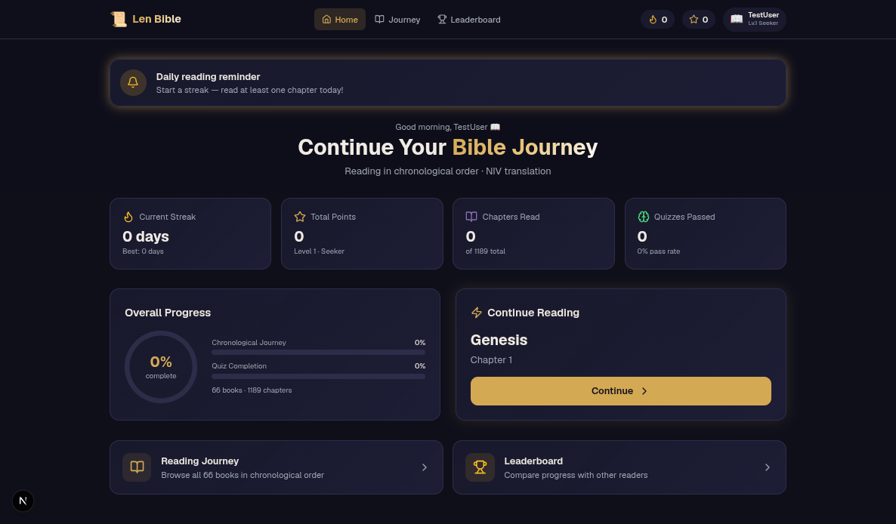

[](LICENSE)
[](https://nextjs.org/)
[](CONTRIBUTING.md)

# Len Bible 📜

> A gamified chronological Bible reading app — read, understand, and track your journey through Scripture.



## Features

- **Chronological reading** — 66 books in event order (Genesis → Revelation)
- **Real Bible text** — fetched live from [helloao.org](https://bible.helloao.org/)
- **Comprehension quizzes** — generated from actual chapter text (not trivia or memorization)
- **Auto chapter completion** — scroll through + brief reflection time
- **6 Bible versions** — each mapped to a real open translation
- **Book overviews** — NIV-style summaries before every book
- **Streaks, points, levels, leaderboard** — progress tracked locally

## Tech stack

| Layer | Technology |
|-------|------------|
| Framework | [Next.js 16](https://nextjs.org/) (App Router) |
| UI | [React 19](https://react.dev/), [Tailwind CSS 4](https://tailwindcss.com/) |
| State | [Zustand](https://zustand.docs.pmnd.dev/) (localStorage persistence) |
| Animation | [Framer Motion](https://www.framer.com/motion/) |
| Language | TypeScript |

## Getting started

### Prerequisites

- Node.js 20+
- npm 10+

### Install

```bash
git clone https://github.com/LENI4C/len-bible.git
cd len-bible
npm install
```

### Environment setup

```bash
cp .env.example .env.local
```

| Variable | Required | Description |
|----------|----------|-------------|
| `API_BIBLE_KEY` | No | [API.Bible](https://scripture.api.bible/signup) key for licensed translations (NIV, NLT, etc.) |

Without a key, the app uses free open-source translations and shows which source is being served.

### Run

```bash
npm run dev          # starts dev server (auto-clears stale lock)
npm run dev:clean    # clears .next cache + starts dev server
```

Open **http://localhost:3000** — you should see the onboarding screen.

### Troubleshooting

If the page is blank or the dev server won't start:

```bash
pkill -f "next dev"    # stop orphaned servers
npm run dev:clean      # clear cache and restart
```

> **About `.next/dev/lock`:** Next.js creates this file while dev is running to prevent port conflicts. `npm run dev` removes stale locks automatically. The file is gitignored.

### Other scripts

```bash
npm run lint        # ESLint
npm run typecheck   # TypeScript check
npm run build       # Production build
npx tsx scripts/scan-quizzes.ts   # Audit quiz quality across all chapters
```

## Project structure

```
src/
├── app/                  # Next.js App Router pages and API routes
│   ├── api/bible/        # GET chapter text by version/book/chapter
│   ├── api/quiz/         # GET generated quiz for a chapter
│   ├── read/             # Chapter reader (scroll-based completion)
│   ├── quiz/             # Understanding check after reading
│   ├── review/           # Review missed quiz questions
│   ├── journey/          # All 66 books with progress
│   ├── leaderboard/      # Local leaderboard
│   └── profile/          # User stats and version picker
├── components/           # Shared UI (Navbar, progress bars, onboarding)
├── hooks/                # React hooks (chapter completion, store hydration)
├── lib/                  # Core logic
│   ├── quiz-generator.ts # Quiz generation from chapter verses
│   ├── bible-server.ts   # Fetches text from helloao.org / API.Bible
│   ├── bible-versions.ts # Translation source mapping
│   ├── books.ts          # Book metadata (chapters, IDs)
│   ├── chronological-order.ts  # 66-book reading order
│   └── book-summaries.ts # NIV-style book overviews
└── store/                # Zustand progress store (localStorage)
scripts/
├── dev.mjs               # Dev server wrapper (stale lock cleanup)
└── scan-quizzes.ts       # Full-corpus quiz quality audit
```

## Contributing

Contributions are welcome! Please read [CONTRIBUTING.md](CONTRIBUTING.md) for setup, branch naming, commit conventions, and how the quiz system works.

All contributors are expected to follow our [Code of Conduct](CODE_OF_CONDUCT.md).

## License

This project is licensed under the [MIT License](LICENSE) — Copyright (c) 2026 Leni4c.

## Data sources & attribution

Len Bible does **not** ship Bible text. All Scripture is fetched at runtime from third-party APIs:

| Provider | URL | Role |
|----------|-----|------|
| **helloao.org** | [bible.helloao.org](https://bible.helloao.org/) | Default free translations (BSB, NET, ASV, etc.) |
| **API.Bible** | [scripture.api.bible](https://scripture.api.bible/) | Optional licensed translations when `API_BIBLE_KEY` is set |

**Important:** Translation text, copyright, and licensing terms belong to the respective providers and copyright holders (e.g. Biblica for NIV, Tyndale for NLT). Len Bible is an independent reading tool and is not affiliated with or endorsed by any Bible publisher or translation provider.

Book overviews in `src/lib/book-summaries.ts` are original summaries written for this app, inspired by NIV-style introductions.

The chronological reading order follows a 66-book event sequence used within this project.
